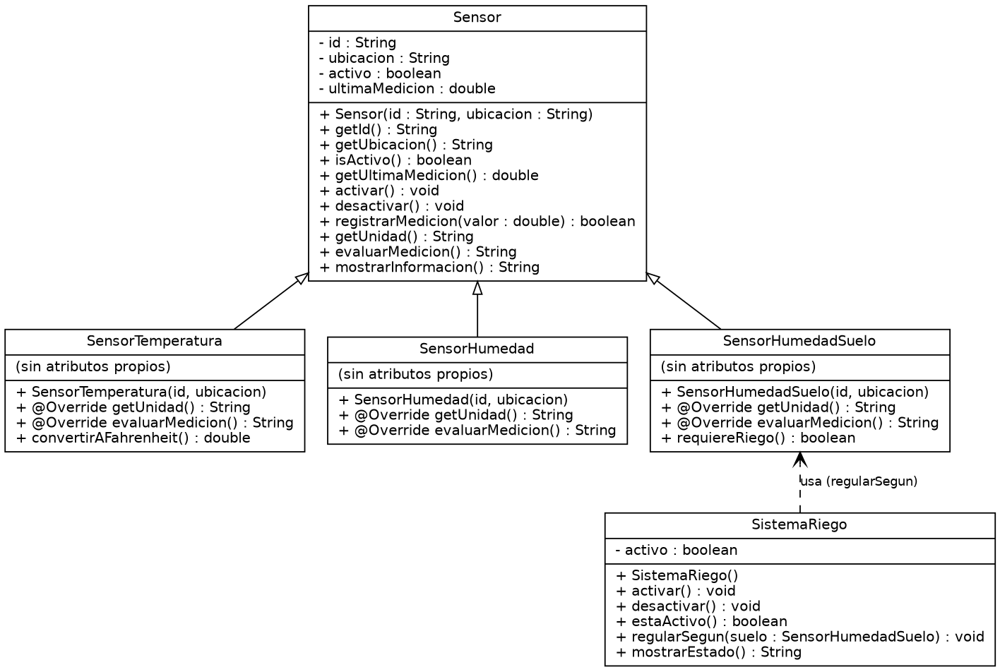

# Análisis y diseño

## 1. Descripción del problema

Voy a representar un invernadero inteligente simplificado que funciona con el ciclo **observar → evaluar → actuar**.

- **Información que maneja:** de cada sensor, su identificación, ubicación, estado (activo/inactivo) y última medición simulada (°C o %); del riego, su estado (ACTIVO/INACTIVO).
- **Elementos que intervienen:** tres sensores (temperatura del aire, humedad ambiental, humedad del suelo) y un sistema de riego.
- **Operaciones generales:** registrar una medición, interpretarla según el tipo de sensor (baja/adecuada/alta), consultar la información del sensor, activar/desactivar el riego y decidir el riego a partir de la humedad del suelo.

El mismo número significa cosas distintas según la variable (32 es temperatura alta, humedad ambiental baja o humedad del suelo adecuada), por eso la interpretación depende del tipo de sensor.

## 2. Identificación de objetos

| Objeto | Qué representa | Por qué es objeto | Responsabilidad |
|---|---|---|---|
| Sensor (general) | Cualquier sensor del invernadero | Tiene identidad, estado y comportamiento comunes | Guardar id, ubicación, estado y última medición; registrar medición |
| Sensor de temperatura | Sensor del aire en °C | Interpreta con criterios propios | Evaluar temperatura baja/adecuada/alta |
| Sensor de humedad ambiental | Sensor de humedad del aire en % | Interpreta con criterios propios | Evaluar humedad ambiental |
| Sensor de humedad del suelo | Sensor del suelo en % | Interpreta con criterios propios y sirve para decidir el riego | Evaluar humedad del suelo e indicar si requiere riego |
| Sistema de riego | Dispositivo que suministra agua | Tiene estado propio y acciones propias | Activar, desactivar y reportar su estado |

El invernadero como tal no lo modelo como clase: `Main` coordina los objetos en esta práctica.

## 3. Estado y comportamiento

| Objeto propuesto | Responsabilidad | Información que debe conservar | Comportamientos que debe realizar |
|---|---|---|---|
| Sensor | Representar lo común a todos los sensores | Identificación, ubicación, estado, última medición | Permitir conocer sus datos, activarse/desactivarse, registrar una medición, interpretar su medición, mostrar su información |
| Sensor de temperatura | Interpretar temperatura | (lo heredado) | Interpretar con rangos de °C; expresar su medición en °F |
| Sensor de humedad ambiental | Interpretar humedad del aire | (lo heredado) | Interpretar con rangos de % de aire |
| Sensor de humedad del suelo | Interpretar humedad del suelo | (lo heredado) | Interpretar con rangos de suelo; indicar si requiere riego |
| Sistema de riego | Suministrar agua | Si está activo o inactivo | Activarse, detenerse, informar su estado, decidir con base en la humedad del suelo |

## 4. Características comunes y especialización

- **Información en común:** identificación, ubicación, estado activo/inactivo y última medición.
- **Comportamientos en común:** registrar una medición, consultarla, activarse/desactivarse y mostrar su información.
- **Lo que cambia según el tipo:** la unidad (°C o %), los criterios de interpretación y los comportamientos particulares.
- **Concepto general:** *Sensor*.
- **Especializaciones:** sensor de temperatura, de humedad ambiental y de humedad del suelo.

## 5. Relaciones entre objetos

| Relación | Tipo | ¿Herencia? |
|---|---|---|
| Sensor de temperatura **ES UN** Sensor | Generalización/especialización | Sí |
| Sensor de humedad ambiental **ES UN** Sensor | Generalización/especialización | Sí |
| Sensor de humedad del suelo **ES UN** Sensor | Generalización/especialización | Sí |
| Sistema de riego **UTILIZA** información del sensor de humedad del suelo | Colaboración | No |

- **Colaboran:** el sensor de humedad del suelo y el sistema de riego. El riego necesita saber si el suelo requiere riego; el sensor no necesita conocer al riego.
- **No se duplica:** id, ubicación, estado y medición viven solo en la superclase; la decisión de regar vive en el riego, no en el sensor.

**¿Por qué `SistemaRiego` no debería ser subclase de `Sensor`?** Porque un sensor *observa* (produce y interpreta una medición) y el riego *actúa* (suministra agua). El riego no tiene ubicación de medición ni última medición ni interpretación; heredar le daría atributos y métodos que no le corresponden. La relación correcta es "utiliza", no "es un".

## 6. Diseño de clases

| Clase | Atributos propuestos | Tipo de dato | Métodos propuestos | Responsabilidad |
|---|---|---|---|---|
| Sensor | `- id`, `- ubicacion`, `- activo`, `- ultimaMedicion` | String, String, boolean, double | `Sensor(id, ubicacion)`, getters, `activar()`, `desactivar()`, `registrarMedicion(double)`, `evaluarMedicion()`, `mostrarInformacion()` | Datos y comportamiento comunes |
| SensorTemperatura | (ninguno propio) | — | constructor, `@Override evaluarMedicion()`, `convertirAFahrenheit()` | Interpretar °C |
| SensorHumedad | (ninguno propio) | — | constructor, `@Override evaluarMedicion()` | Interpretar humedad ambiental |
| SensorHumedadSuelo | (ninguno propio) | — | constructor, `@Override evaluarMedicion()`, `requiereRiego()` | Interpretar suelo e indicar necesidad de riego |
| SistemaRiego | `- activo` | boolean | `SistemaRiego()`, `activar()`, `desactivar()`, `estaActivo()`, `mostrarEstado()` | Estado y acciones del riego |

- **Private:** todos los atributos; solo se cambian con métodos (`registrarMedicion`, `activar`, `desactivar`).
- **Por constructor:** `id` y `ubicacion` en los sensores. El sensor inicia activo con medición 0; el riego inicia inactivo.
- **Consultables:** mediante getters (`getId`, `getUltimaMedicion`, `isActivo`, `estaActivo`).
- **En la clase general:** lo común. **Solo en subclases:** criterios de interpretación y comportamientos particulares.

## 7. Jerarquía de clases

- **Jerarquía:** `Sensor` ← `SensorTemperatura`, `SensorHumedad`, `SensorHumedadSuelo`.
- **Solo colabora:** `SistemaRiego` usa información del sensor de humedad del suelo.

## Diagrama UML inicial

## 8. Justificación del diseño

- **Por qué estas clases:** una por cada elemento del problema con responsabilidad propia, más una superclase para lo compartido.
- **Responsabilidad principal:** `Sensor` guarda y registra datos; cada subclase interpreta su variable; `SistemaRiego` controla el agua.
- **Atributos private:** para que no se modifiquen desde `Main` (por ejemplo `sensor.ultimaMedicion = 25`) y el objeto controle su estado.
- **Constructores:** `id` y `ubicacion`; las subclases los pasan con `super(...)`.
- **Superclase:** `Sensor`. **Subclases:** `SensorTemperatura`, `SensorHumedad`, `SensorHumedadSuelo`.
- **Por qué "es un":** cada una es un tipo de sensor y tiene todo lo que un sensor tiene.
- **En la superclase:** id, ubicación, estado, medición y su manejo. **En las subclases:** interpretación y comportamientos propios.
- **Por qué `SistemaRiego` no está en la jerarquía:** actúa, no mide (ver sección 5).
- **Evitar duplicación:** ninguna subclase redeclara atributos; la decisión de riego no se repite en el sensor.

## 9. Constructores y super

- **¿Los constructores de la superclase se heredan?** No. Cada subclase declara el suyo.
- **¿Qué constructor se ejecuta primero?** El de la superclase `Sensor`, y después el de la subclase.
- **¿Para qué usé `super(id, ubicacion)`?** Para inicializar la parte `Sensor` del objeto (id, ubicación, estado, medición) sin repetir esa asignación en cada subclase; además los atributos son `private` y las subclases no pueden asignarlos directamente.

## 10. Sobrescritura

- **¿Qué método sobrescribí?** `evaluarMedicion()` (y también `getUnidad()`, para mostrar la unidad correcta).
- **¿Qué indica `@Override`?** Que el método reemplaza uno de la superclase; el compilador marca error si la firma no coincide.
- **¿Por qué el mismo nombre?** Porque la acción es la misma (interpretar la medición) aunque el criterio cambie por tipo.
- **Ventaja:** desde cualquier `Sensor` basta llamar `evaluarMedicion()`, sin conocer su tipo ni tener métodos distintos (`evaluarTemp`, `evaluarSuelo`...). Agregar un sensor nuevo no obliga a cambiar el código que ya los procesa.

## 11. Polimorfismo y enlace dinámico

En `Main` uso `Sensor[] sensores = {s1, s2, s3}` con `Sensor s1 = new SensorTemperatura(...)`, `Sensor s2 = new SensorHumedad(...)` y `Sensor s3 = new SensorHumedadSuelo(...)`, y las recorro con `for (Sensor sensor : sensores) sensor.evaluarMedicion()`, sin `if/else` por tipo.

| Tipo de referencia | Tipo real del objeto | Método que se ejecuta |
|---|---|---|
| Sensor | SensorTemperatura | `SensorTemperatura.evaluarMedicion()` (rangos 18 y 30 °C) |
| Sensor | SensorHumedad | `SensorHumedad.evaluarMedicion()` (rangos 40 y 70 %) |
| Sensor | SensorHumedadSuelo | `SensorHumedadSuelo.evaluarMedicion()` (rangos 30 y 70 %) |

- **¿Por qué `Sensor` puede apuntar a un `SensorTemperatura`?** Porque un `SensorTemperatura` *es un* `Sensor`; tiene todo lo que la superclase declara.
- **¿Puede una referencia `SensorTemperatura` apuntar a cualquier `Sensor`?** No. Un `Sensor` cualquiera podría ser de humedad y no tendría los métodos de temperatura; el compilador no lo permite sin casting.
- **¿Qué versión se ejecuta en `sensor.evaluarMedicion()`?** La de la clase real del objeto, no la del tipo de la referencia.
- **¿Cómo lo decide Java?** En tiempo de ejecución, según el objeto al que apunta la referencia (enlace dinámico).
- **Polimorfismo:** en el ciclo `for (Sensor sensor : sensores)` de `Main`, donde la misma llamada produce resultados distintos (con 32: "Temperatura alta", "Humedad ambiental baja" o "Humedad del suelo adecuada").
- **Enlace dinámico:** en esa misma llamada `sensor.evaluarMedicion()`; la implementación se elige al ejecutar.

## 12. instanceof y casting

Agregué `convertirAFahrenheit()` solo en `SensorTemperatura` y `requiereRiego()` solo en `SensorHumedadSuelo`; no están en `Sensor`. En `Main`, con una referencia `Sensor`, uso `if (sensor instanceof SensorTemperatura)` y luego `(SensorTemperatura) sensor` para llamar al método específico (igual con el suelo).

- **¿Por qué fue necesario el casting?** Porque el tipo de la referencia es `Sensor` y el compilador solo deja ver lo que `Sensor` declara.
- **¿Qué comprueba `instanceof`?** Si el objeto real es de ese tipo (o subtipo), para que el casting sea seguro.
- **¿Qué pasa con una subclase incorrecta?** Se lanza `ClassCastException` en ejecución.
- **¿Por qué no sustituir el polimorfismo con `instanceof`?** Porque obliga a una cadena de `if/else` por tipo que hay que modificar con cada sensor nuevo. Lo uso solo para lo que no existe en la superclase.

## 13. Sistema de riego

**¿El riego "es un" sensor o utiliza información de los sensores?** Utiliza información de los sensores.

- **En el código:** `SistemaRiego` no extiende nada; su método `regularSegun(SensorHumedadSuelo suelo)` recibe el sensor y llama a `suelo.requiereRiego()`; si es `true` activa el riego y si no, lo desactiva. `Main` los conecta con `instanceof`/casting sobre la colección.
- **En el UML:** flecha de dependencia (punteada) de `SistemaRiego` hacia `SensorHumedadSuelo`, sin flecha de herencia.
- **Resultado:** con suelo 22 % el riego queda ACTIVO; con 51 % queda INACTIVO.

## 14. Pruebas realizadas

Ejecutadas con la clase `PruebasInvernadero` (sin JUnit): 22 verificaciones, 22 correctas.

| Caso | Resultado esperado | Resultado |
|---|---|---|
| Crear los diferentes sensores | Conservan id, ubicación y estado | ✔ |
| Temperatura 15 / 25 / 34 | Baja / adecuada / alta | ✔ |
| Humedad ambiental 32 / 55 / 82 | Baja / adecuada / alta | ✔ |
| Humedad del suelo 18 / 48 / 83 | Baja / adecuada / alta | ✔ |
| Procesar sensores con referencias `Sensor` (valor 32) | Alta / baja / adecuada según su tipo | ✔ |
| Recorrer la colección | Todos procesables con el tipo común | ✔ |
| `instanceof` | Identifica el tipo (verdadero y falso) | ✔ |
| Casting tras `instanceof` | 32 °C → 89.6 °F | ✔ |
| Suelo 22 % | Riego activo | ✔ |
| Suelo 55 % / 85 % | Riego inactivo | ✔ |
| Sensor inactivo | No registra la medición | ✔ |

## Cambios realizados al diseño

| Cambio | Motivo |
|---|---|
| Se agregó `getUnidad()` en `Sensor` y se sobrescribió en las subclases | `mostrarInformacion()` necesitaba mostrar °C o % sin escribir la unidad en la superclase |
| Se agregó `SistemaRiego.regularSegun(SensorHumedadSuelo)` | Para que el riego use la medición del suelo en vez de que `Main` decida por él |
| La dependencia del riego pasó de `Sensor` a `SensorHumedadSuelo` | Solo ese sensor tiene `requiereRiego()` |
| Se agregó la clase `PruebasInvernadero` | Ejecutar los casos de prueba obligatorios |

## Diagrama UML final

